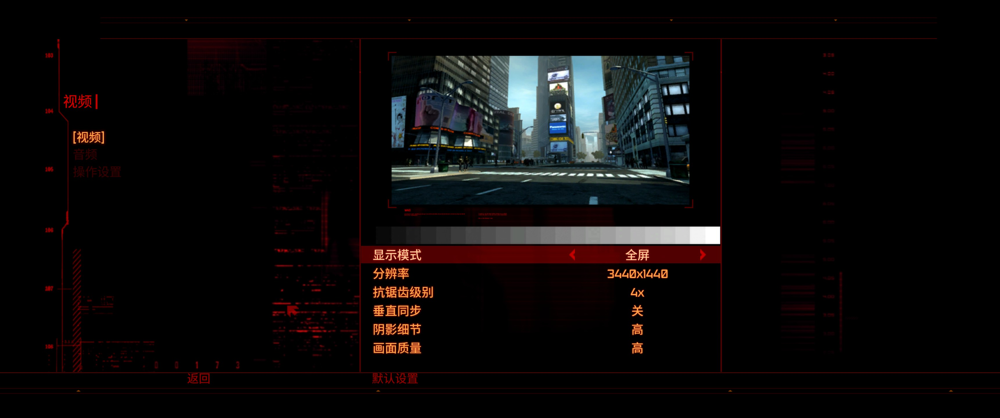

[中文](README.md) | [English](README_EN.md)

# Prototype (2009) Modern Compatibility Patch

A modern compatibility patch for the PC version of **Prototype (2009)**, focused on startup compatibility, modern resolutions, display modes, stability, and selected high-framerate gameplay issues.

**Current release:** [v0.3.3 Preview](https://github.com/OBLPlife/Prototype-Modern-Compatibility/releases/tag/v0.3.3)

Chinese localization patch: [Prototype-Chinese](https://github.com/OBLPlife/Prototype-Chinese)

## Screenshots



## Installation & Restoration

**Install**

1. Exit the game and Steam.
2. Download the [English installer](https://github.com/OBLPlife/Prototype-Modern-Compatibility/releases/tag/v0.3.3) (`Prototype_Modern_Compatibility_EN_Setup.exe`) or the Chinese installer (`Prototype_Modern_Compatibility_CN_Setup.exe`) from [Releases](https://github.com/OBLPlife/Prototype-Modern-Compatibility/releases).
3. Place the installer in the game directory, alongside `prototypef.exe`.
4. Run the installer and select **Install**.
5. Restart Steam and launch the game as instructed by the installer. If a startup helper is required, run `PrototypeModern_Play.lnk` from the game directory.

**Restore**

Exit the game and Steam, run the installer again, and select **Restore**.

The installer backs up and verifies files affected by the patch. Keep its backup directories intact. Where Steam launch integration is used, the installer configures game-specific launch options and restores the previous settings when the patch is removed.

## Features

### Startup & Stability

- Fixes cases where the game process starts but no window appears.
- Fixes cases where game audio plays but the main window remains invisible.
- Addresses a memory-lifetime race condition in the original game's network worker shutdown.
- Corrects selected audio output format and audio queue waiting issues.
- Reduces redundant engine and graphics resource operations.

### Modern Resolutions & Display Modes

- Removes the original in-game resolution selection limit of 1920×1200.
- Enumerates resolutions supported by the current display and allows selection, application, and saving through the original game menu.
- Adds three display modes: **Fullscreen** (exclusive), **Borderless**, and **Windowed**.
- Supports display-mode confirmation, cancellation, and timeout recovery.
- Improves ultrawide pause menus, map visibility, and selected loading screens.
- Corrects horizontal stretching of selected logos, interface elements, and loading animations.
- Improves mouse cursor handling and aspect-ratio presentation in windowed mode.

### Modern Hardware Support

- Improves GPU, video memory, and display output detection.
- Selects graphics adapters based on the active display output.
- Uses a D3D9Ex compatibility bridge for selected legacy Direct3D 9 device operations.
- Reduces selected redundant resource queries, texture bindings, and device operations.

### High-Framerate & Gameplay Fixes

- Adjusts timing gates in the original rendering dispatch and simulation update paths.
- Preserves the original timing, pause, and slow-motion mechanisms.
- Improves rigid-body movement consistency across simulation update rates.
- Fixes high-FPS issues that make tank, armored vehicle, and helicopter hijacking excessively difficult.
- Improves valid button-press responsiveness during vehicle hijacking.
- Fixes ability-wheel input issues caused by lost subpixel mouse movement at high frame rates.
- Improves timing behavior for selected special abilities.

## Performance Diagnostics

The patch includes local performance diagnostics. On eligible fresh installations running 64-bit Windows, a collection component is automatically configured to record frame times, CPU/GPU samples, and selected engine events while the game runs.

Diagnostic log directory: `%LOCALAPPDATA%\PrototypeModern\Performance`

Individual log files have size limits.

## Building from Source

This repository includes the compatibility module, graphical installer, build utilities, and the Python embeddable runtime needed to build the installers.

**Requirements:** Windows, Visual Studio C++ x86 build tools (default MSVC 14.44.35207), Windows SDK (default 10.0.26100.0), .NET Framework 4.x C# compiler, and PowerShell.

Run from the repository root:

```powershell
.\build.ps1
```

Output files are written to `build/`:

- `PrototypeModern.dll` — core compatibility module
- `PrototypeModern_Start.exe` — startup helper
- `Prototype_Modern_Compatibility_CN_Setup.exe` — Chinese installer
- `Prototype_Modern_Compatibility_EN_Setup.exe` — English installer

### Repository Layout

| Path | Contents |
| --- | --- |
| `src/` | C++ compatibility module, display, input, timing, and gameplay fixes |
| `installer/` | GUI installer, backups, restoration, and Steam launch integration |
| `tools/` | Build utilities, asset generation, performance diagnostics, and checks |
| `vendor/` | Python embeddable runtime |
| `build.ps1` | Windows build script |

## License

This project is licensed under the [PolyForm Noncommercial License 1.0.0](LICENSE), allowing noncommercial use, modification, and distribution. **Unauthorized commercial use and resale are prohibited.**

## Important Notice

**This is a preview release. Unknown issues may still exist.**
